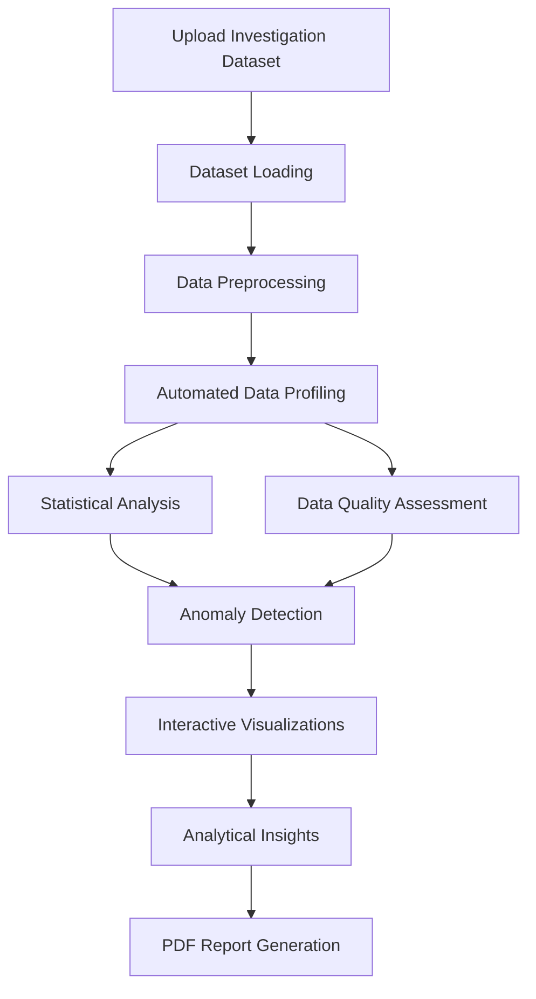

# 🔎 FORENSIQ — Investigation Intelligence Platform

\<p align="center">
&#x20; \<strong>Transforming Raw Data into Meaningful Investigative Insights\</strong>
\</p>

\<p align="center">
&#x20; An automated Exploratory Data Analysis (EDA) platform designed to help investigators examine datasets, identify unusual patterns, detect anomalies, and generate structured analytical reports.
\</p>

\<p align="center">
&#x20; ![Python]\([https://img.shields.io/badge/Python-3.11-blue?logo=python](https://img.shields.io/badge/Python-3.11-blue?logo=python))
&#x20; ![Streamlit]\([https://img.shields.io/badge/Streamlit-Framework-red?logo=streamlit](https://img.shields.io/badge/Streamlit-Framework-red?logo=streamlit))
&#x20; ![Pandas]\([https://img.shields.io/badge/Pandas-Data%20Analysis-150458?logo=pandas](https://img.shields.io/badge/Pandas-Data%20Analysis-150458?logo=pandas))
&#x20; ![Plotly]\([https://img.shields.io/badge/Plotly-Visualization-3F4F75?logo=plotly](https://img.shields.io/badge/Plotly-Visualization-3F4F75?logo=plotly))
&#x20; ![Status]\([https://img.shields.io/badge/Status-Active%20Development-success](https://img.shields.io/badge/Status-Active%20Development-success))
\</p>

---

## 📌 Overview

**FORENSIQ** is a web-based investigation intelligence and data analysis platform that automates the process of exploring and examining structured datasets.

Traditional data investigation often involves manually inspecting records, calculating statistics, creating visualizations, and identifying unusual observations. FORENSIQ simplifies this process by bringing these analytical capabilities together in one interface.

Users can upload a dataset and obtain automated statistical summaries, data quality assessments, anomaly detection results, interactive visualizations, and analytical reports.

The platform aims to make exploratory data analysis more accessible, understandable, and efficient.

## 🎯 Key Features

### 1. Evidence Dataset Upload

- Upload datasets for investigation and analysis.
- Automatically load and process uploaded data.
- Examine dataset structure and column information.

### 2. Automated Data Profiling

- Identify dataset dimensions.
- Examine numerical and categorical columns.
- Calculate descriptive statistics.
- Detect missing values and duplicate records.
- Generate an overview of data quality.

### 3. Anomaly Detection

- Identify statistically unusual observations.
- Highlight potentially suspicious data patterns.
- Flag records for further examination.
- Present anomaly detection results for investigator review.

### 4. Interactive Data Visualization

- Histograms for understanding data distributions.
- Box plots for examining spread and potential outliers.
- Correlation heatmaps for identifying relationships.
- Bar charts for comparing categorical values.

### 5. Statistical Analysis

- Mean, median, minimum and maximum.
- Standard deviation and distribution analysis.
- Outlier identification.
- Column-wise statistical examination.

### 6. AI-Assisted / Automated Insights

- Generate understandable observations from analytical results.
- Examine relationships and unusual patterns.
- Provide a question-based interface for exploring dataset information.

### 7. PDF Report Generation

- Generate structured investigation analysis reports.
- Include dataset summaries and analytical observations.
- Export findings for documentation and review.

---

## ⚙️ How FORENSIQ Works

The application follows a structured data analysis workflow:



### Workflow Explanation

| Stage                | Description                                                   |
| -------------------- | ------------------------------------------------------------- |
| Dataset Upload       | User uploads a dataset for examination.                       |
| Data Loading         | The application reads and processes the uploaded data.        |
| Data Profiling       | Examines records, columns, missing values and duplicates.     |
| Statistical Analysis | Calculates descriptive statistical measures.                  |
| Anomaly Detection    | Identifies observations that may require further review.      |
| Visualization        | Displays distributions, correlations and unusual patterns.    |
| Insights             | Converts analytical results into understandable observations. |
| Reporting            | Generates a downloadable PDF analysis report.                 |

---

## 🛠️ Technology Stack

| Technology           | Purpose                                           |
| -------------------- | ------------------------------------------------- |
| Python               | Core programming language                         |
| Streamlit            | Interactive web application                       |
| Pandas               | Data manipulation and analysis                    |
| NumPy                | Numerical computations                            |
| Plotly               | Interactive data visualizations                   |
| Scikit-learn / SciPy | Statistical and analytical operations, where used |
| Matplotlib / Seaborn | Data visualization, where used                    |
| ReportLab            | PDF report generation, where used                 |

---

## 📂 Project Structure

```text
FORENSIQ/
│
├── app.py
│
├── modules/
│   ├── data_loader.py
│   ├── data_profiler.py
│   ├── anomaly_detector.py
│   ├── visualizations.py
│   ├── column_analyzer.py
│   └── report_generator.py
│
├── utils/
│   └── helper_functions.py
│
├── assets/
│   └── screenshots/
│
├── requirements.txt
├── .gitignore
└── README.md
```

*Note: This is a suggested documentation structure. Adjust filenames and folders to match the actual repository.*

---

## 🚀 Getting Started

Follow these instructions to run FORENSIQ locally.

### Prerequisites

- Python 3.11 or compatible version
- Git
- VS Code (recommended)

### 1. Clone the Repository

```bash
git clone https://github.com/YOUR_USERNAME/FORENSIQ.git
```

### 2. Navigate to the Project Directory

```bash
cd FORENSIQ
```

### 3. Create a Virtual Environment

```bash
python -m venv venv
```

Activate it on Windows:

```powershell
venv\Scripts\activate
```

### 4. Install Dependencies

```bash
python -m pip install --upgrade pip
pip install -r requirements.txt
```

### 5. Run the Application

```bash
python -m streamlit run app.py
```

### 6. Open in Browser

```text
http://localhost:8501
```

---

## 🖥️ Application Screenshots

Add screenshots of your actual application here.

| Application Section  | Screenshot                              |
| -------------------- | --------------------------------------- |
| Landing Page         | `assets/screenshots/homepage.png`       |
| Dataset Upload       | `assets/screenshots/upload.png`         |
| Statistical Analysis | `assets/screenshots/statistics.png`     |
| Anomaly Detection    | `assets/screenshots/anomalies.png`      |
| Data Visualizations  | `assets/screenshots/visualizations.png` |
| PDF Report           | `assets/screenshots/report.png`         |

To display a screenshot directly:

```markdown

```

---

## 🌐 Live Application

**Live Demo:** [https://forensiq-4aqeenebh7jkssrk8spl2e.streamlit.app/](https://forensiq-4aqeenebh7jkssrk8spl2e.streamlit.app/)

**GitHub Repository:** [https://github.com/saanvi-aggarwal/FORENSIQ](https://github.com/saanvi-aggarwal/FORENSIQ)

---

## 🔮 Future Enhancements

- Advanced anomaly detection techniques.
- Improved statistical interpretation and automated findings.
- Evidence relationship analysis.
- Enhanced interactive investigation dashboards.
- Support for additional structured data formats.
- Investigation history and session management.
- More comprehensive downloadable reports.
- Secure user authentication and access control.

##
